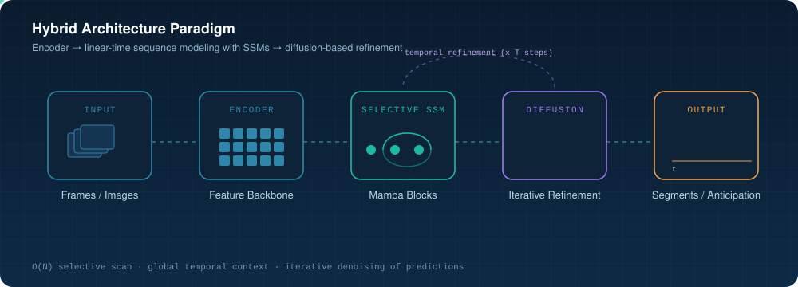

 

---

## About

I am an AI researcher and computer vision engineer at the **Digital Image Processing Lab, Islamia College Peshawar**. My work covers the full research pipeline: architecture design, training, optimization, and evaluation of deep learning systems for visual understanding.

My research centers on **hybrid architectures** that combine Transformers, state space models (Mamba), and diffusion models, applied to panoptic segmentation, temporal action segmentation, and video understanding.

| | |
|---|---|
| **Research areas** | Computer Vision · Panoptic Segmentation · State Space Models · Diffusion Models · Multimodal AI |
| **Current focus** | PanopMamba: robust panoptic segmentation under adverse weather |
| **Approach** | End-to-end pipelines, from architecture design to training and evaluation |
| **Goal** | Contributing to peer-reviewed publications at high-impact AI venues |

---

## Research Landscape

---

## Research Paradigm

---

## Selected Projects

<table>
<tr>
<td width="50%" valign="top">

### PanopMamba
**Robust Panoptic Segmentation in Adverse Weather**

- Efficient Mamba-based architecture for scene understanding under fog, rain, and snow
- Targets reliable perception for autonomous systems in degraded visibility

</td>
<td width="50%" valign="top">

### MambaDiff
**State Space Models Meet Diffusion for Temporal Action Segmentation**

- Integrates SSMs with diffusion-based temporal refinement
- Hybrid framework evaluated on benchmark action segmentation datasets

</td>
</tr>
<tr>
<td colspan="2" valign="top">

### MTAF-GCN
**Multi-Topology Attention-Fused GCN for Sign Language Recognition**

- Graph neural network framework over MediaPipe landmark sequences
- Optimized for real-time gesture recognition

</td>
</tr>
</table>

---

## Technical Stack

<table>
<tr>
<td width="22%"><b>Languages</b></td>
<td>

</td>
</tr>
<tr>
<td><b>Deep Learning</b></td>
<td>

</td>
</tr>
<tr>
<td><b>Computer Vision</b></td>
<td>

</td>
</tr>
<tr>
<td><b>Tooling</b></td>
<td>

</td>
</tr>
<tr>
<td><b>Platforms</b></td>
<td>

</td>
</tr>
</table>

---

## GitHub Activity

---

## Collaboration

I am open to collaboration on **computer vision**, **video understanding**, and **generative or state space modeling**. If your work overlaps, feel free to reach out.

 

